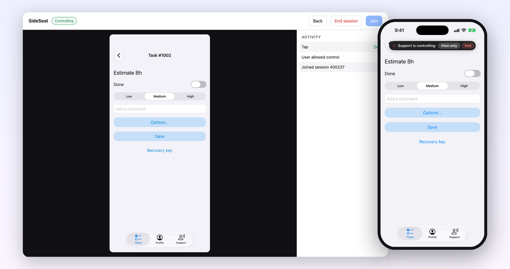
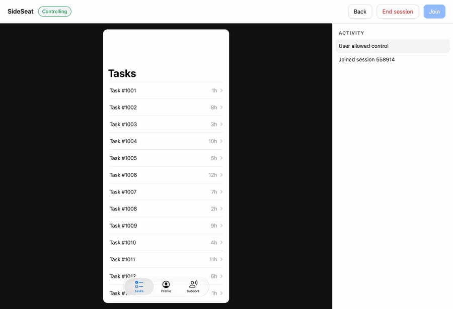
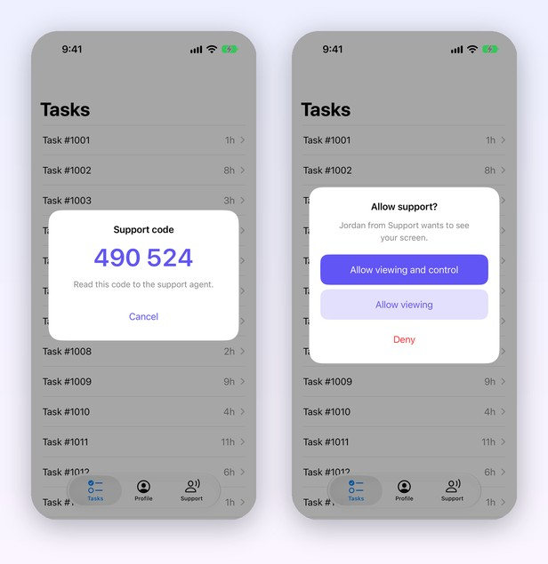
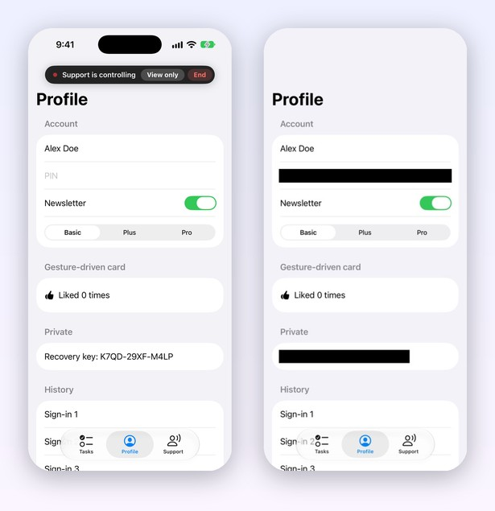

<h1 align="center">SideSeat</h1>

<p align="center">
  <strong>In-app remote support for iOS.</strong><br>
  See your user's screen and, with their consent, help them through it. No screen sharing app, no private APIs.
</p>

<p align="center">
  <a href="https://github.com/mohameditani91/SideSeat/actions/workflows/ci.yml"></a>
  
  
  
  
  <a href="LICENSE"></a>
</p>

<p align="center">
  
</p>

A support agent opens a web page, types the 6-digit code shown in your app, and sees the user's screen live. With the user's consent, the agent can also tap, scroll, type and go back.

## Features

- **App Store safe.** Public APIs only. No touch synthesis, no private selectors. Agent input is replayed the way UIKit itself would handle it: control actions, table and collection selection through their delegates, popovers closing through their delegates, scroll offsets, text input.
- **Consent first.** Nothing streams until the user allows viewing, or viewing and control. The user can drop to view-only or end the session at any time from a banner they can drag out of the way.
- **Masking.** Secure text fields are always painted black. Mark anything else with one property, or mask whole screens with a rule.
- **No dependencies.** About 2,000 lines of Swift. iOS 15+, UIKit and SwiftUI.
- **Bring your own backend.** A small reference relay and agent console are included for local development. The transport is a protocol, so you can run sessions over your own infrastructure.

## See it in action

An agent opens a task, marks it done, sets the priority, types a comment and saves, all from the browser. Every input shows up in the activity log with its result.

<p align="center">
  
</p>

| Pairing and consent | What the user sees vs. what the agent sees |
| :---: | :---: |
|  |  |

## Try it in two minutes

You need Node 18+ and Xcode 15+.

1. Start the relay and console:
   ```bash
   cd Examples/Relay && npm install && npm start
   ```
2. Open `Examples/SampleApp/SampleApp.xcodeproj` and run it on a simulator.
3. In the sample app, open the **Support** tab and tap **Start support session**. A code appears.
4. Open http://localhost:8080, enter the code and your name, and approve the request in the app.

Click on the screen to tap, use the trackpad or wheel to scroll, and type with the console focused. To test on a real device, run the relay with `HOST=0.0.0.0` and point the sample app at your Mac's IP in the Support tab.

## Add it to your app

Swift Package Manager: in Xcode choose **File › Add Package Dependencies…** and enter the repository URL, or add it to `Package.swift`:

```swift
.package(url: "https://github.com/mohameditani91/SideSeat.git", from: "0.1.0")
```

Then add the `SideSeat` product to your target.

```swift
import SideSeat

var configuration = SideSeat.Configuration(relay: URL(string: "wss://support.example.com/device")!)
SideSeat.shared.start(in: windowScene, configuration: configuration)
```

`SideSeat.shared.end()` stops the session, and `onStateChange` reports `connecting`, `waitingForAgent(code:)`, `awaitingConsent`, `active(mode:)` and `ended`.

## What the agent can do

| Input | Handled |
| --- | --- |
| Tap | Buttons and other controls, switches, segmented controls, sliders, text fields, table and collection cells (`willSelect`/`shouldSelect`/`didSelect` honored), popovers closing on an outside tap (delegate honored), accessibility-activatable views, SwiftUI views marked with `.sideSeatTarget` |
| Scroll | The scroll view under the pointer that can move in that direction, clamped to its content |
| Type | Text, Backspace and Return into the focused field (`textFieldShouldReturn` honored) |
| Back | Pops the visible navigation stack, or dismisses a modal |

Things it can't drive, by design: custom gesture recognizers, web views, games, and SwiftUI gestures without a marker. Make them reachable with:

```swift
// UIKit: views driven by gestures
extension MyCardCell: SideSeatTappable {
    func sideSeatTap(at point: CGPoint) -> Bool {
        toggleExpanded()
        return true
    }
}

// SwiftUI: views driven by onTapGesture
Card()
    .onTapGesture { likes += 1 }
    .sideSeatTarget { likes += 1 }
```

## Masking

```swift
pinLabel.isSideSeatMasked = true                               // a UIKit view
Text(cardNumber).sideSeatMasked()                              // a SwiftUI view
configuration.maskRule = MaskRules.screens([PaymentViewController.self])   // whole screens
```

Secure text fields, including SwiftUI `SecureField`, are always masked. Masks are drawn into each frame before it leaves the device, and they follow scrolling.

## Extension points

| Configuration | Use it to |
| --- | --- |
| `request` | Add authentication headers or query items to the relay connection |
| `transport` | Replace the WebSocket with your own `SideSeatTransport` |
| `inputInterceptor` | Block or handle agent input yourself, for example on payment screens |
| `consentHandler` | Show your own consent UI instead of the built-in card |
| `maskRule` | Decide which views to paint black |
| `allowsControl` | Offer viewing only |
| `framesPerSecond`, `scale`, `jpegQuality`, `mainThreadBudget` | Trade picture quality for bandwidth and main-thread time |
| `strings`, `tint` | Localize and theme the built-in UI |

## Protocol

JSON text messages plus binary JPEG frames over one WebSocket per side. The relay pairs one app with one agent by code.

| From | Message |
| --- | --- |
| Relay → app | `session {code}`, `agentJoined {agentId, agentName}`, `agentLeft`, `input {id, action, …}`, `end {reason}` |
| App → relay | `consent {mode}`, `denied`, `screen {width, height}`, `result {id, outcome, reason}`, `mode {mode}`, `end {reason}`, binary JPEG frames |
| Agent → relay | `input {id, action: tap\|scroll\|text\|key\|back, …}`, `end` |

Coordinates are normalized to 0…1 of the app's window scene.

## Before you ship it

The relay in `Examples/Relay` is a starting point for development. It has an optional shared device token (`DEVICE_TOKEN`) and nothing else. For production, run the relay behind TLS (`wss://`), authenticate agents, make codes short-lived and rate-limit attempts, keep an audit log, and decide which screens to mask or block.

## Limitations

- Each frame is drawn on the main thread with `drawHierarchy`. Frame rate drops automatically when a capture takes longer than `mainThreadBudget`. Expect 1–2 fps on the simulator.
- The system keyboard isn't shown to the agent, and Liquid Glass and other blur materials may render without their background.
- One agent per session. If the connection drops, the session ends and the user starts a new one.

## Security

To report a vulnerability, follow [SECURITY.md](SECURITY.md). Please don't open a public issue.

## License

MIT. See [LICENSE](LICENSE).
